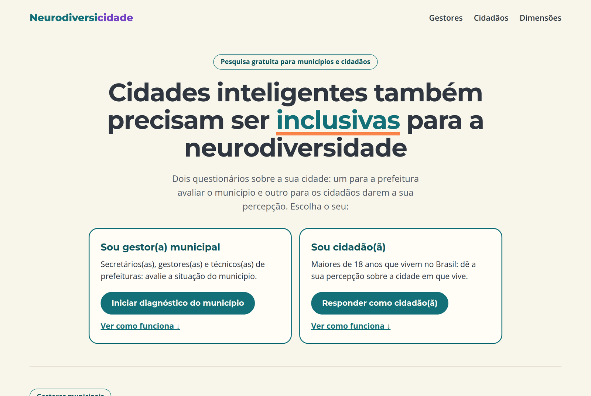
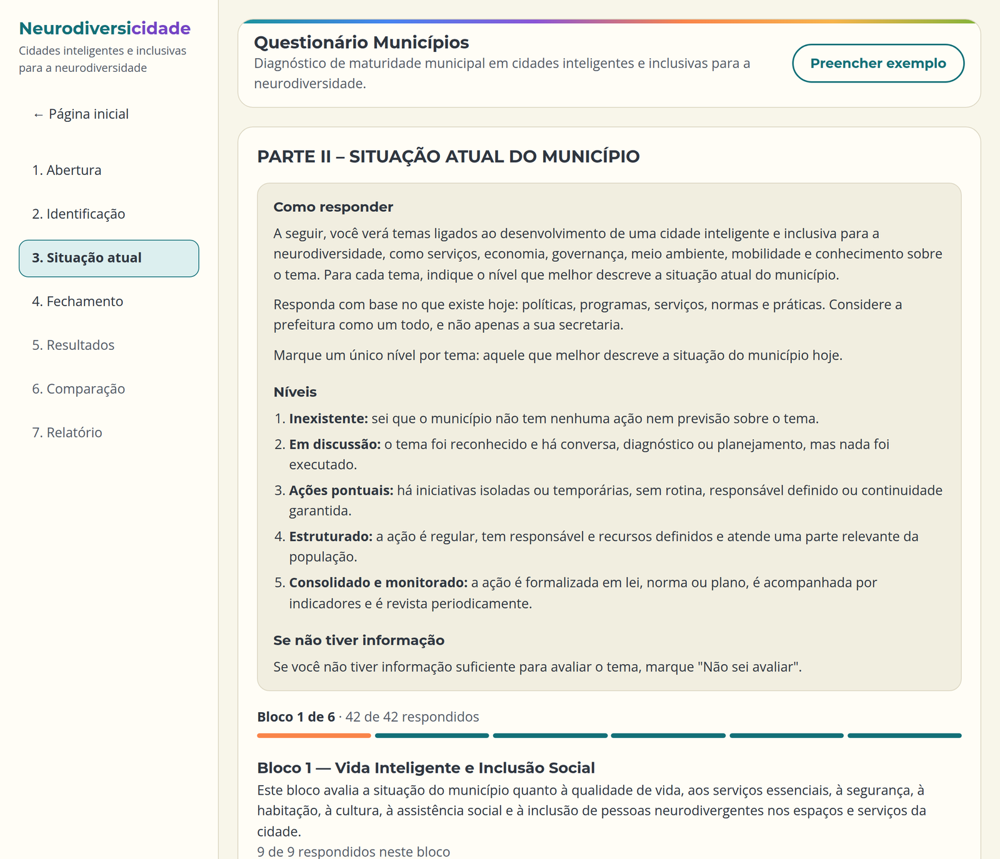
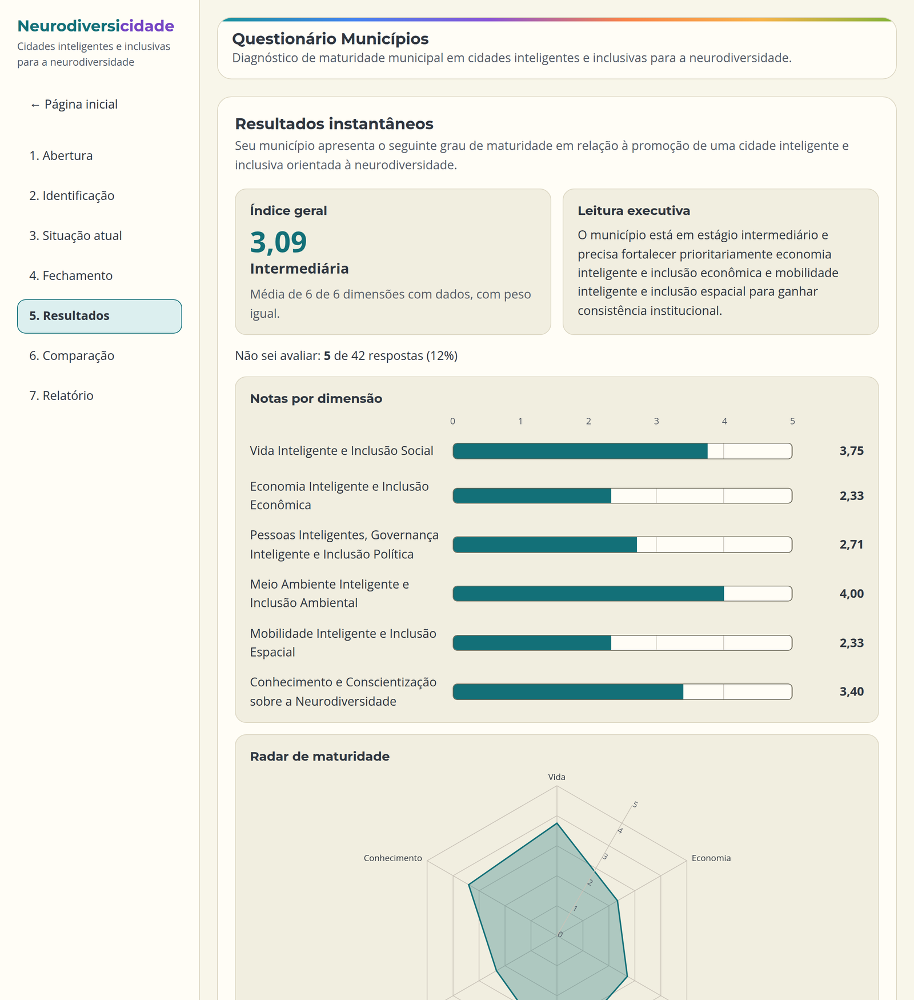
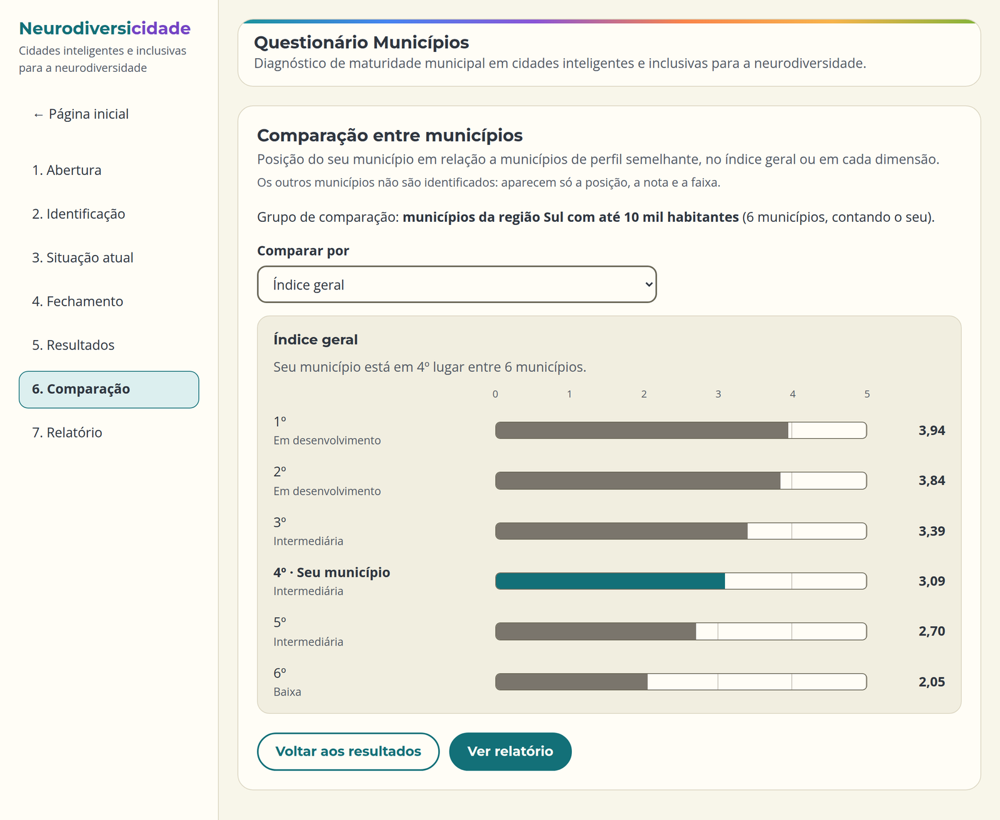
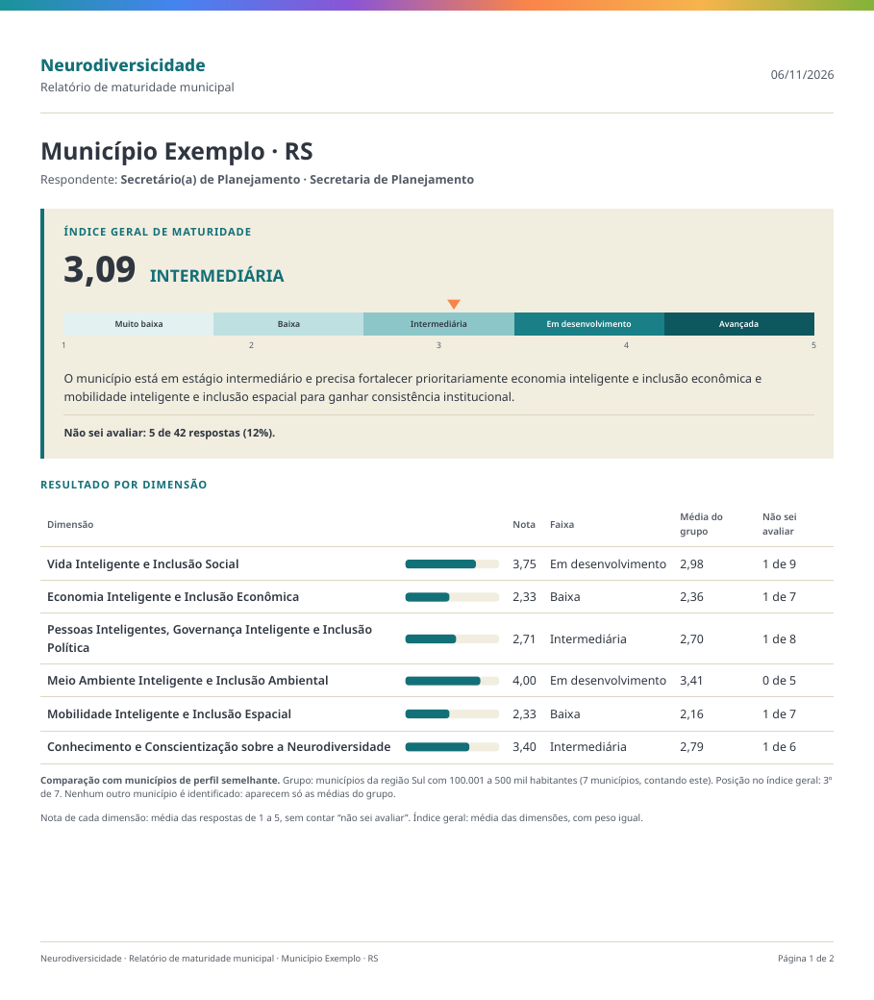
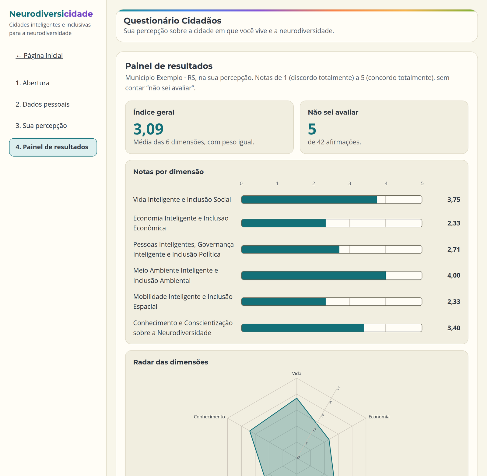
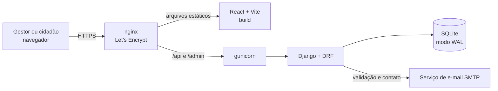

# Neurodiversicidade

Plataforma web de diagnóstico sobre cidades inteligentes e inclusivas para
pessoas neurodivergentes, com dois públicos:

- **Gestores municipais** avaliam a maturidade da prefeitura em 42 temas e
  recebem na hora um painel com gráficos, um relatório em PDF e a comparação com
  municípios de perfil semelhante, sem que nenhum município seja identificado.
- **Cidadãos** dão a sua percepção sobre a cidade em que vivem, de forma
  anônima, e veem o resultado em um painel próprio.

Projeto desenvolvido para um grupo de pesquisa universitário. **O código-fonte é
privado.** Este repositório é uma vitrine de portfólio e as telas mostram apenas
dados fictícios.

> Status: em produção, com domínio próprio e HTTPS, para o lançamento em um
> evento com prefeituras.

## Telas

| Questionário do gestor | Resultado imediato |
| --- | --- |
|  |  |

| Comparação com perfil semelhante | Relatório em PDF |
| --- | --- |
|  |  |

| Painel do cidadão |
| --- |
|  |

## O que a plataforma faz

- **Dois questionários de 42 itens**, nas mesmas 6 dimensões: o do gestor usa
  uma escala de maturidade (de "inexistente" a "consolidado e monitorado") e o
  do cidadão, uma escala de concordância. Os dois têm a opção "não sei avaliar",
  que fica fora do cálculo.
- **Município sem erro de digitação:** o respondente escolhe a UF e depois o
  município numa lista oficial de 5.571 municípios. Porte e região saem da base
  oficial de população, sem perguntar.
- **Diagnóstico imediato** para o gestor: índice geral, nota por dimensão,
  classificação por faixa, leitura executiva, pontos fortes, prioridades e boas
  práticas.
- **Comparação com municípios de perfil semelhante:** mesma região e porte,
  depois só porte, depois todos, parando no primeiro grupo com pelo menos 5
  municípios, para que nenhum seja identificável.
- **Relatório em PDF** com layout próprio para impressão, incluindo a média do
  grupo de comparação.
- **Validação do respondente sem travar o envio:** o gestor confirma o e-mail
  num link enviado depois da resposta, e a equipe também pode validar
  manualmente pelo painel administrativo.
- **Análise por público no lado do cidadão:** as respostas são agrupadas em
  pessoas neurodivergentes, familiares e cidadãos em geral, a partir das
  perguntas de triagem.
- **Página de contato** com envio por e-mail para a equipe e cópia salva no
  painel administrativo.
- **Gestão pelo Django Admin:** consulta, validação, exclusão a pedido do
  titular dos dados e exportação em CSV para análise.

## Arquitetura

Uma única VPS Linux, com o nginx servindo o frontend compilado e repassando a
API ao gunicorn, que roda como serviço do systemd. O certificado HTTPS renova
sozinho. Backup do banco e atualização do servidor são feitos por scripts shell.

## Stack

| Camada | Tecnologias |
| --- | --- |
| Frontend | React 19, TypeScript (`strict`), Vite, Recharts |
| Backend | Python 3.12, Django 6, Django REST Framework |
| Banco | SQLite em modo WAL |
| Infraestrutura | Linux (VPS), nginx, gunicorn, systemd, Let's Encrypt |
| Qualidade | 89 testes automáticos no backend, oxlint, checagem de tipos no build |

## Decisões técnicas

- **Link secreto em vez de login.** Não há contas de usuário: o gestor volta ao
  relatório por um link enviado por e-mail. O banco guarda só o hash SHA-256 do
  token, então quem tiver acesso ao banco não consegue montar os links.
- **Anonimato na comparação.** O endpoint público devolve só notas, sem nome, UF
  ou id. A lista depende apenas do perfil do grupo, nunca de quem consulta:
  assim, comparar duas consultas não revela a nota de ninguém. A própria
  avaliação sai da lista só com o token secreto.
- **Validação que resiste a antivírus.** Filtros de e-mail costumam abrir os
  links sozinhos. Por isso a confirmação acontece num botão (POST) dentro da
  página, e nunca ao abrir o link (GET).
- **Dados sensíveis separados.** As respostas dos cidadãos ficam em tabelas
  próprias, sem nome, e-mail ou IP. Os e-mails de quem pede aviso de materiais
  ficam numa lista que não se liga a nenhuma resposta.
- **Textos dos documentos, sem retrabalho.** Os textos dos questionários foram
  extraídos direto dos documentos oficiais (Word) por script, e testes conferem
  trechos-chave. Isso evita erros de digitação em 84 itens.
- **Mesma conta nos dois lados.** O frontend calcula o resultado na hora e o
  backend refaz a conta para o CSV. As regras são espelhadas, inclusive o
  arredondamento, que difere entre Python e JavaScript, e um teste confere que
  os dois chegam ao mesmo número.
- **TypeScript sem `any`.** Toda resposta da API é lida como `unknown` e
  validada antes do uso.
- **Endpoints públicos com cuidado.** Cada endpoint declara as permissões de
  forma explícita, os de escrita têm limite de requisições por IP e o formulário
  de contato tem uma armadilha contra robôs. O frontend chama a API no mesmo
  domínio da página, sem CORS em produção.
- **SQLite em produção.** Para o volume esperado (dezenas de prefeituras e
  algumas centenas de cidadãos), o SQLite em modo WAL elimina um serviço de
  banco separado. A troca para PostgreSQL fica pronta via `DATABASE_URL`.

## Autor

Desenvolvido por [Renato Machado](https://github.com/renatorms).
