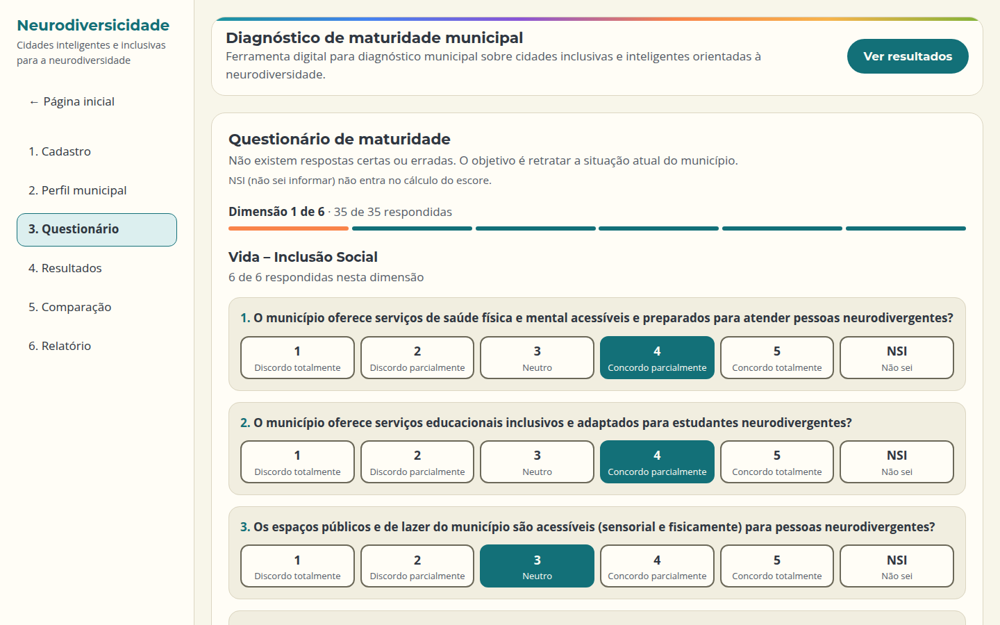
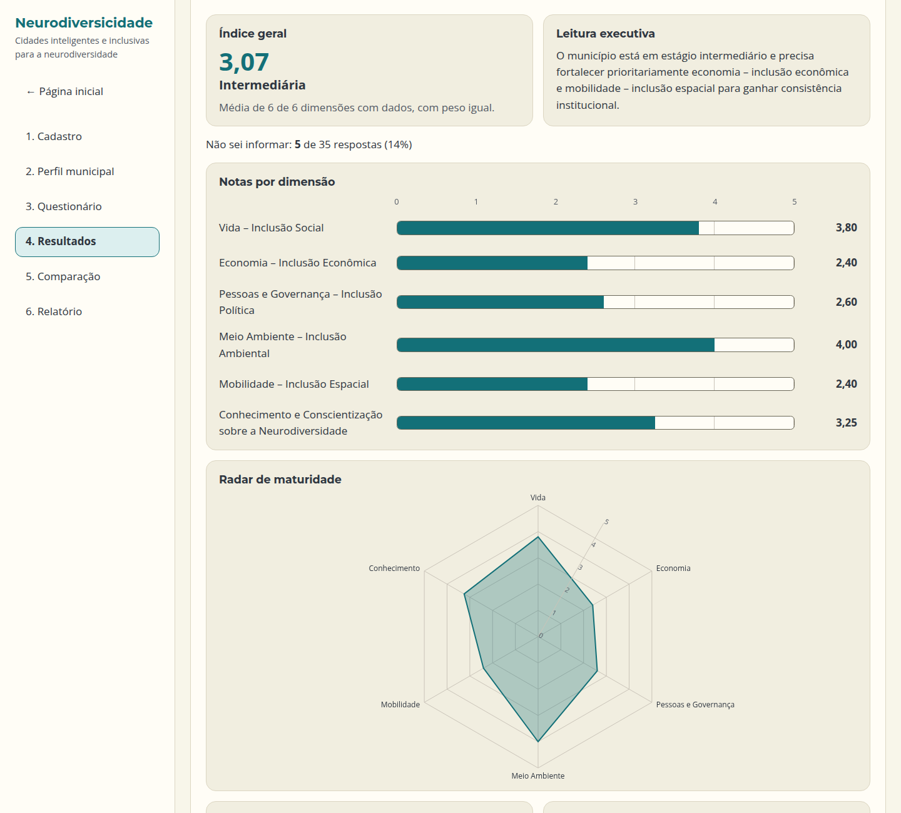
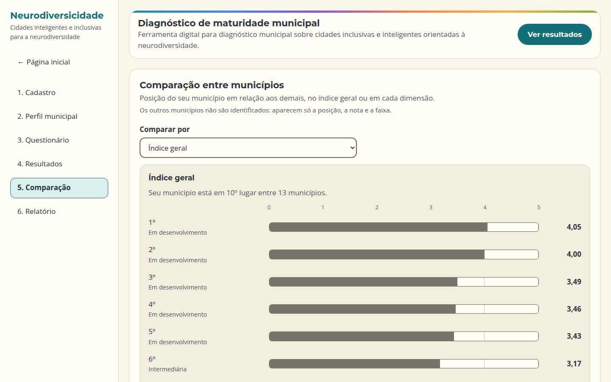
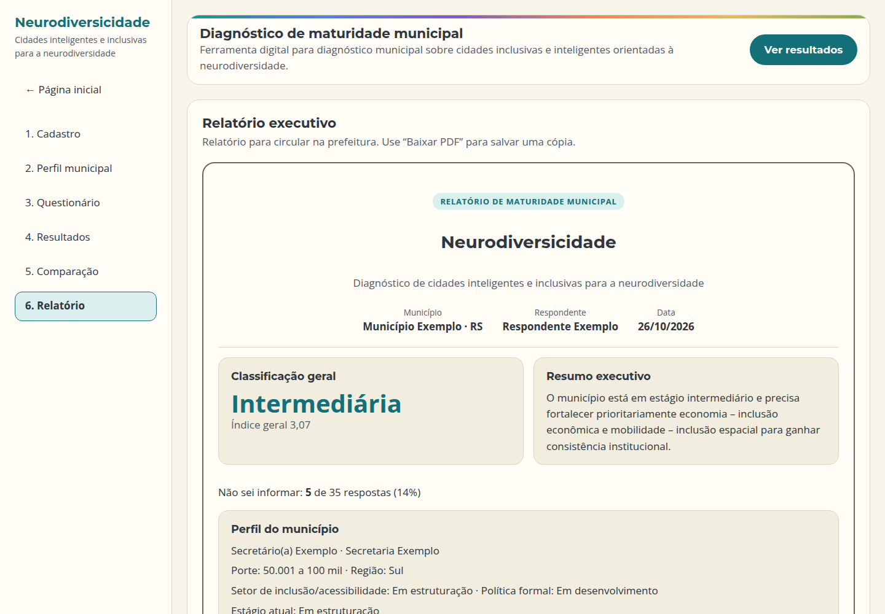
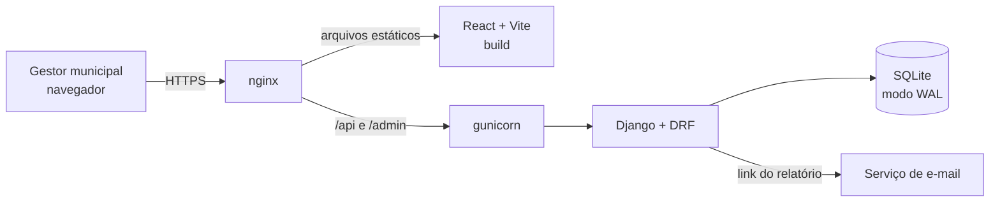

# Neurodiversicidade

Plataforma web de autoavaliação para prefeituras. O gestor municipal responde a
um questionário sobre cidades inteligentes e inclusivas para pessoas
neurodivergentes e recebe na hora um diagnóstico com gráficos, um relatório em
PDF e a posição do município em relação aos demais, sem que ninguém seja
identificado.

Projeto desenvolvido para um grupo de pesquisa universitário. **O código-fonte é
privado.** Este repositório é uma vitrine de portfólio e as telas mostram apenas
dados fictícios.

> Status: MVP concluído, em preparação para o lançamento.

## Telas

| Questionário | Resultado |
| --- | --- |
|  |  |

| Comparação anônima | Relatório em PDF |
| --- | --- |
|  |  |

## O que a plataforma faz

- **Questionário em etapas:** cadastro, perfil do município e 6 dimensões
  apresentadas uma por tela, com escala Likert de 1 a 5 e a opção "não sei".
- **Diagnóstico imediato:** nota por dimensão, índice geral e uma faixa de
  maturidade (de "muito baixa" a "avançada"), em gráfico de radar e de barras.
  Quando há muitas respostas "não sei", o resultado avisa.
- **Comparação anônima:** o município se vê em relação aos demais, mas a API
  pública devolve só números, sem nome, UF ou id. A lista sai ordenada pela nota,
  para que a posição não revele a ordem de envio.
- **Relatório executivo:** página pronta para impressão em PDF, com ações
  institucionais recomendadas e boas práticas para as dimensões prioritárias.
- **Volta sem login:** ao terminar, o gestor recebe por e-mail um link secreto
  para o próprio relatório.
- **Gestão pelo Django Admin:** leitura das avaliações e exportação em CSV para
  a equipe de pesquisa.

## Arquitetura

Uma única VPS Linux, com o nginx servindo o frontend compilado e repassando a
API ao gunicorn, que roda como serviço do systemd. Backup do banco e
atualização do servidor são feitos por scripts shell.

## Stack

| Camada | Tecnologias |
| --- | --- |
| Frontend | React 19, TypeScript (`strict`), Vite, Recharts |
| Backend | Python 3.12, Django 6, Django REST Framework |
| Banco | SQLite em modo WAL |
| Infraestrutura | Linux (VPS), nginx, gunicorn, systemd |
| Qualidade | testes do Django (41 casos na API), oxlint, checagem de tipos no build |

## Decisões técnicas

- **Link secreto em vez de login.** O MVP não tem contas de usuário. O banco
  guarda só o hash SHA-256 do token do relatório: quem tiver acesso ao banco
  não consegue montar os links.
- **Privacidade na comparação.** O endpoint público expõe apenas notas, e só de
  quem marcou o consentimento para entrar na comparação.
- **Integridade no banco, não só no código.** Restrições `UniqueConstraint`
  garantem uma avaliação por município, uma resposta por pergunta e versões
  únicas do instrumento.
- **Mesma conta nos dois lados.** O frontend calcula o resultado na hora e o
  backend refaz a conta para o CSV. As regras são espelhadas (inclusive o
  arredondamento, que difere entre Python e JavaScript) e um teste confere que
  os dois chegam ao mesmo número.
- **TypeScript sem `any`.** Toda resposta da API é lida como `unknown` e
  validada antes do uso.
- **Endpoints públicos com cuidado.** Cada endpoint declara as permissões de
  forma explícita, os de escrita e de consulta do relatório têm limite de
  requisições (throttling) e o CORS só aceita origens listadas.
- **SQLite em produção.** Para o volume esperado (dezenas de prefeituras), o
  SQLite em modo WAL elimina um serviço de banco separado. A troca para
  PostgreSQL fica pronta via `DATABASE_URL`, se o volume crescer.

## Autor

Desenvolvido por [Renato Machado](https://github.com/renatorms).
